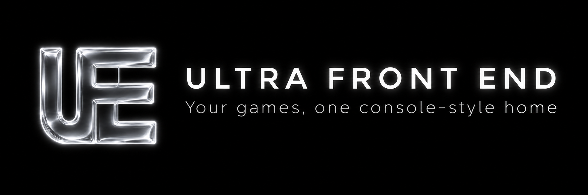
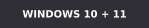

<p align="center">
  
</p>

<p align="center">
  <a href="https://github.com/ImSammyTTV/Ultra-Front-End/releases/latest"></a>
  <a href="https://github.com/ImSammyTTV/Ultra-Front-End/releases"></a>
  
  <a href="LICENSE"></a>
  <a href="https://ko-fi.com/imsammyttv"></a>
</p>

<p align="center">
  <b>Ultra Front End</b> is a fullscreen, controller-first game launcher for Windows.<br>
  Your PC games, emulators and ROMs on one console-style home screen, with a menu you can open over any game.
</p>

<p align="center">
  <a href="https://github.com/ImSammyTTV/Ultra-Front-End/releases/latest"><b>Download</b></a> ·
  <a href="#quick-start"><b>Quick start</b></a> ·
  <a href="#controls"><b>Controls</b></a> ·
  <a href="#roms-and-bios"><b>ROMs and BIOS</b></a> ·
  <a href="#help"><b>Help</b></a> ·
  <a href="https://github.com/ImSammyTTV/Ultra-Front-End/issues/new"><b>Report a bug</b></a>
</p>

---

## Features

<table>
<tr>
<td width="50%" valign="top">

### Every game in one place
**Steam, Epic Games, EA app, Ubisoft Connect, GOG, Rockstar Games and Battle.net**, plus your own games folders and
ROMs. Store games start through their own launcher, so sign-in, updates and cloud saves still work.

</td>
<td width="50%" valign="top">

### Emulators set up for you
Pick the consoles you play and their emulators are set up for you. You can add new ones any time in
**Settings › Systems**.

</td>
</tr>
<tr>
<td valign="top">

### In-game menu
Open it over any game for **volume, music, screenshots, recording** and **Close game**. While it's open, your
controller works the menu, not the game.

</td>
<td valign="top">

### Artwork
Covers come from Steam and libretro automatically. Connect **SteamGridDB** (free, optional) to pick any game's cover,
background and logo, **animated ones too**.

</td>
</tr>
<tr>
<td valign="top">

### Extras
A **performance overlay**, a **controller tester**, achievements, game news and an **album** of your screenshots and
videos.

</td>
<td valign="top">

### Keeps itself up to date
Updates install by themselves when you're **not playing**. Choose **Main** or **Nightly** in **Settings › About**.
It can start with Windows, ready for the Xbox button.

</td>
</tr>
</table>

---

## Quick start

1. **Download** `UltraFrontEnd-Setup.exe` from the [latest release](https://github.com/ImSammyTTV/Ultra-Front-End/releases/latest)
   and run it. Everything goes in `C:\Ultra-Front-End`: the app in `App`, with your `ROMs` and `Emulators` beside it.
   No administrator prompt is needed.
2. **Follow the setup guide.** Pick your consoles and whether it starts with Windows.
3. **Play.** Installed games are found by themselves. Connect store accounts in **Settings › Accounts** for the rest.

> [!TIP]
> **Windows says it "protected your PC"?** The app isn't signed yet. Click **More info › Run anyway**.

> [!NOTE]
> Windows is the only platform for now.

---

## Controls

| Button | Home screen | In a game |
|---|---|---|
| **A** / **B** | Select / Back | |
| **Y** or **Start** | Game menu | |
| **View** | Quick Access | |
| **LB** / **RB** | Change tab | |
| **Xbox**, **Steam** or **View + Start** | Open the frontend | In-game menu |
| **View + RB** | | Screenshot |
| **View + LB** | | Start or stop recording |

A keyboard (arrow keys, **Enter**, **Esc**), a mouse and touch screens work too.

---

## ROMs and BIOS

Setup makes a folder for each console. Drop your games into the right one:

```
C:\Ultra-Front-End\ROMs
├── PS2
│   ├── BIOS          ← the console's BIOS files (see the README.txt inside)
│   └── My Game.iso
├── GameCube
│   └── …
└── PS1
    ├── BIOS          ← scph5501.bin and the other PS1 BIOS files
    └── …
```

Each `BIOS` folder's `README.txt` lists the files that console needs, and they're copied to the emulator for you.
Zipped games are unpacked when you play them.

> [!IMPORTANT]
> **Ultra Front End doesn't come with any games, ROMs, BIOS files or console keys, and never downloads them.** Use
> only games and system files you've copied from your own consoles and discs. Downloading them from elsewhere is
> against the law in most countries. The emulators it installs are separate projects, each with its own license.

---

## Help

<details>
<summary><b>A game is missing</b></summary>

Installed games from the supported stores are found by themselves. For Steam games you haven't installed, and for
Epic, connect the account in **Settings › Accounts**. For anything else, add its folder (or a single game) in
**Settings › Libraries**.
</details>

<details>
<summary><b>An emulated game won't start</b></summary>

Open **Settings › Systems** and choose the console. Its page says whether the emulator is installed and which BIOS files
are missing. Some consoles (PS1, PS2, Saturn and others) can't start any game without them.
</details>

<details>
<summary><b>The in-game menu doesn't open</b></summary>

It opens over games started from the frontend. Check that **Settings › General › Open with the Xbox button** is on.
With a Steam Controller, press the Steam button once in the game.
</details>

<details>
<summary><b>Custom artwork</b></summary>

Go to **Settings › Accounts › SteamGridDB**, choose **Open SteamGridDB**, sign in (or make a free account), choose
**Generate API Key** and paste it into the frontend. Then press **Y** on any game and choose **Artwork**.
</details>

<details>
<summary><b>Where are my settings and logs?</b></summary>

In `C:\Ultra-Front-End\App\data`. `errors.log` holds any errors and `emulator-install.log` any emulator install that
failed. Updating never removes them.
</details>

<details>
<summary><b>Usage stats</b></summary>

Ultra Front End checks in once a day so I can see roughly how many people are playing with it. It only counts copies:
nothing about you or your games is included. To opt out, turn off **Settings › About › Count this copy**.
</details>

**Found a bug or have an idea?** [Open an issue](https://github.com/ImSammyTTV/Ultra-Front-End/issues/new). Say what
you expected and what happened, and attach `errors.log` if there is one.

---

## License

[MIT](LICENSE) © ImSammyTTV. Third-party software and artwork: [THIRD_PARTY_NOTICES.md](THIRD_PARTY_NOTICES.md).
