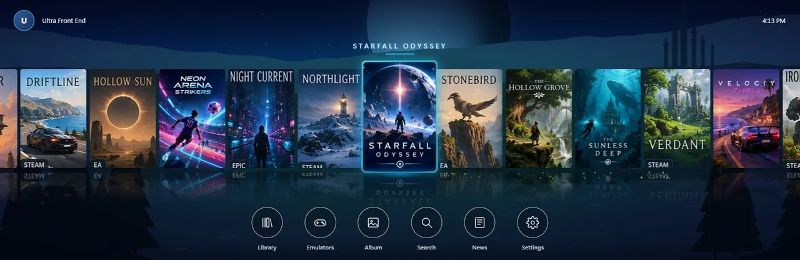
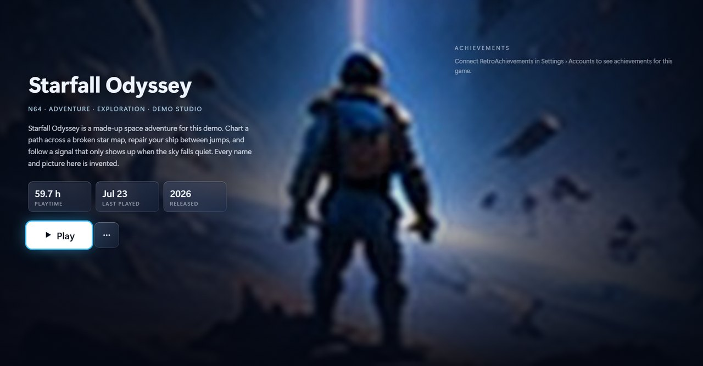
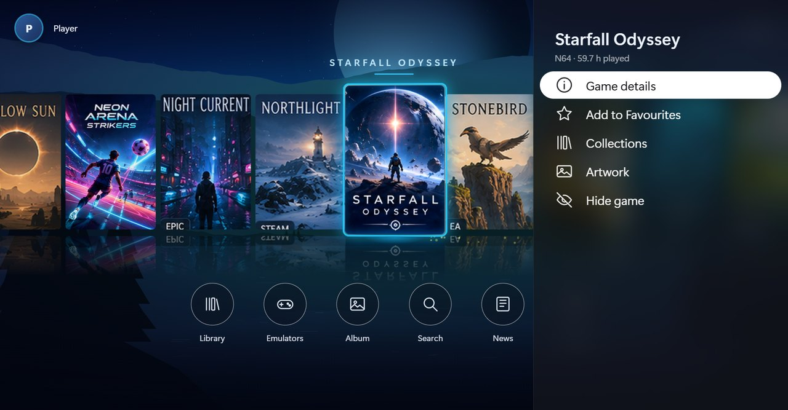
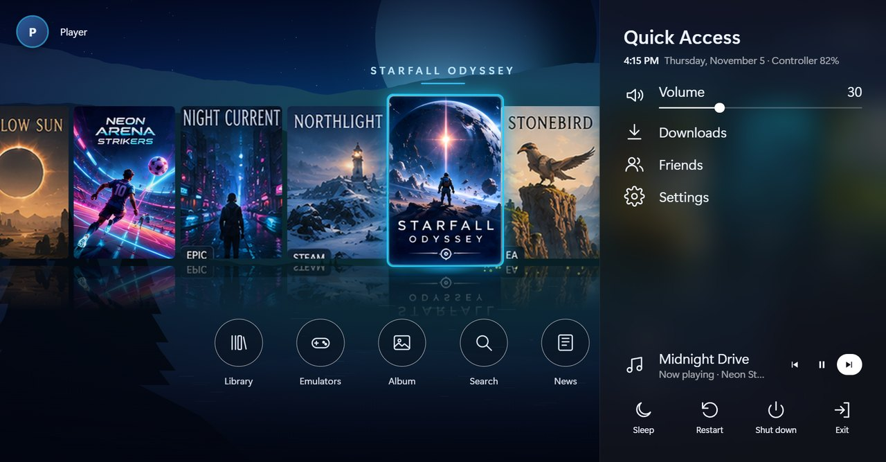
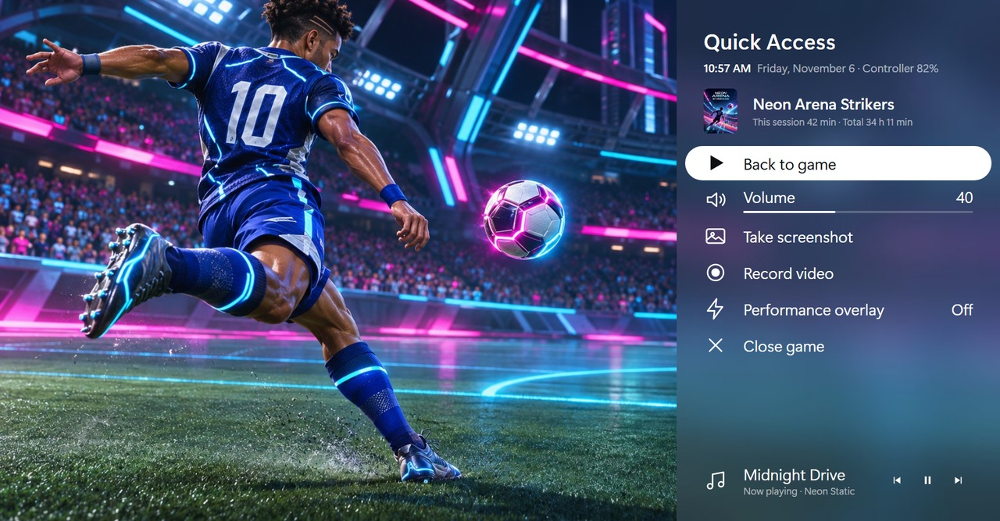
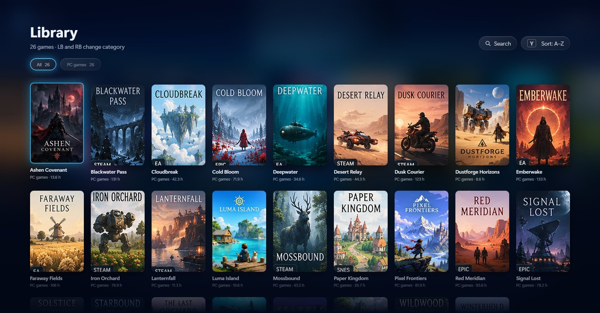
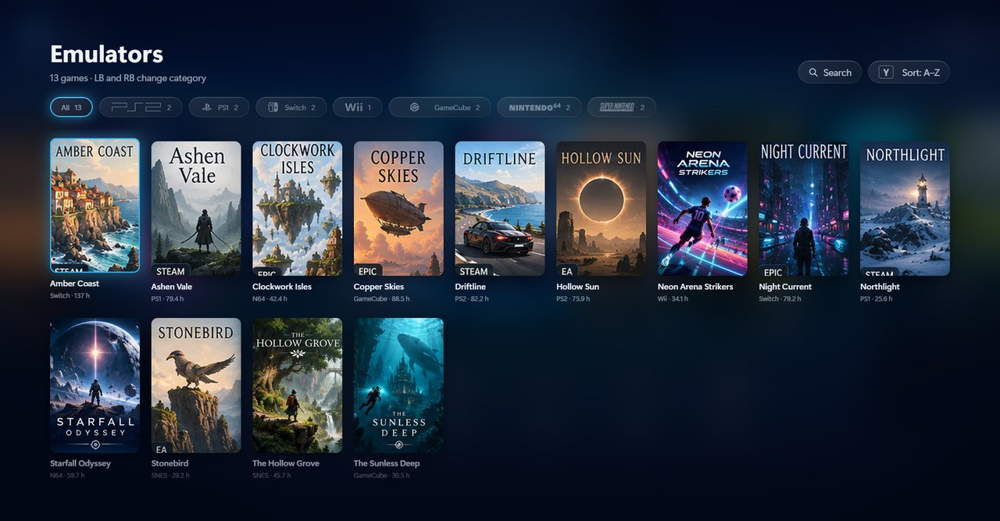

<p align="center">
  
</p>

<p align="center">
  <a href="https://github.com/ImSammyTTV/Ultra-Front-End/releases/latest"></a>
  <a href="https://github.com/ImSammyTTV/Ultra-Front-End/releases"></a>
  
  <a href="LICENSE"></a>
</p>

<p align="center">
  <b>Ultra Front End</b> is a fullscreen, controller-first game launcher for Windows. Your PC games, emulators and ROMs<br>
  on one console-style home screen, with an in-game menu you can open over any game.
</p>

<p align="center">
  <a href="https://github.com/ImSammyTTV/Ultra-Front-End/releases/latest"><b>⬇️ Download</b></a> ·
  <a href="#-quick-start"><b>🚀 Quick start</b></a> ·
  <a href="#-controls"><b>🎮 Controls</b></a> ·
  <a href="#%EF%B8%8F-roms-and-bios"><b>🗂️ ROMs and BIOS</b></a> ·
  <a href="#%EF%B8%8F-artwork"><b>🖼️ Artwork</b></a> ·
  <a href="#-help"><b>❓ Help</b></a> ·
  <a href="https://github.com/ImSammyTTV/Ultra-Front-End/issues/new"><b>🐛 Report a bug</b></a>
</p>

---

## ✨ Features

<table>
<tr>
<td width="50%" valign="top">

### 🕹️ Every game in one place
**Steam, Epic Games, EA app, Ubisoft Connect, GOG, Rockstar Games and Battle.net**, plus your own games folders and ROMs.
Store games start through their own launcher, so sign-in, updates and cloud saves still work. Missing a launcher? Setup can install it.

</td>
<td width="50%" valign="top">

### 🧰 Emulators set up for you
Pick the consoles you play during setup. It makes a ROMs folder for each one and can **install the emulator it needs**,
with a progress bar. Add more consoles later in Settings.

</td>
</tr>
<tr>
<td valign="top">

### 🎛️ In-game menu
Open it over any game for **volume, music controls, screenshots, recording** and **Close game**. While it's open,
your controller works the menu, not the game.

</td>
<td valign="top">

### 🖼️ Artwork without an account
Covers come from Steam and from libretro automatically. Connect **SteamGridDB** (optional, free) to choose any game's
cover, background and logo, **animated ones too**.

</td>
</tr>
<tr>
<td valign="top">

### 🗂️ BIOS and keys made simple
Each console that needs BIOS or firmware files gets a `BIOS` folder inside its ROMs folder, with a note saying
exactly which files go there.

</td>
<td valign="top">

### 📊 Extras
A **performance overlay** (frame rate and more) you can add during setup, a **controller tester**, achievements,
game news and a screenshot **album**.

</td>
</tr>
<tr>
<td valign="top">

### ⬆️ Updates itself
New versions download by themselves and install when you're **not playing**. Can start with Windows, quietly in the
tray, so it's ready when you press the Xbox button.

</td>
<td valign="top">

### 📺 Any screen
Built for TVs and ultrawides as well as handhelds: 16:9, 16:10, 21:9, 4:3 and portrait screens, with touch support
and a UI scale setting.

</td>
</tr>
</table>

---

## 📸 A look around

<table>
<tr>
<td width="50%" align="center">
  <br>
  <sub>Game details</sub>
</td>
<td width="50%" align="center">
  <br>
  <sub>Game menu (<b>Y</b> or <b>Start</b>)</sub>
</td>
</tr>
<tr>
<td align="center">
  <br>
  <sub>Quick Access (<b>View</b>)</sub>
</td>
<td align="center">
  <br>
  <sub>In-game menu</sub>
</td>
</tr>
<tr>
<td align="center">
  <br>
  <sub>Library</sub>
</td>
<td align="center">
  <br>
  <sub>Emulators</sub>
</td>
</tr>
</table>

<sub>Every game, cover and song in these pictures is made up for the demo.</sub>

---

## 🚀 Quick start

1. **Download** `UltraFrontEnd.exe` from the [latest release](https://github.com/ImSammyTTV/Ultra-Front-End/releases/latest).
2. **Put it in a folder of its own** and run it. Its settings are kept in a `data` folder beside it.
3. **Follow the setup guide.** It asks for your name and time zone, your ROMs folder (`C:\ROMs` unless you choose another),
   the consoles you play, and whether it should start with Windows.
4. **Play.** Your installed Steam games are already there. Connect your store accounts in **Settings → Accounts** to add the rest.

> [!TIP]
> **Windows says it "protected your PC"?** The app isn't signed yet, so SmartScreen warns about it. Click **More info → Run anyway**.

---

## 🎮 Controls

| Button | On the home screen | In a game |
|---|---|---|
| **A** | Select | |
| **B** | Back | |
| **Y** or **Start** | Game menu (details, favourites, artwork, hide…) | |
| **View** | Quick Access | |
| **LB / RB** | Change tab | |
| **Xbox button**, **Steam button** or **View + Start** | Open the frontend | In-game menu |
| **View + RB** | | Screenshot |
| **View + LB** | | Start or stop recording |

On a keyboard: arrow keys, **Enter** and **Esc**. A mouse and touch screens work too.

---

## 🗂️ ROMs and BIOS

Setup makes one folder per console inside your ROMs folder. Drop your games into the right one:

```
C:\ROMs
├── PS2
│   ├── BIOS          ← the console's BIOS files, see the README.txt inside
│   └── My Game.iso
├── GameCube
│   └── …
└── Switch
    ├── BIOS          ← prod.keys and firmware
    └── …
```

Each `BIOS` folder has a `README.txt` listing the files that console needs, and the frontend copies them to the emulator
for you. Zipped games are unpacked when you play them.

---

## 🖼️ Artwork

Steam games get their covers from Steam, and emulated games from [libretro](https://github.com/libretro-thumbnails/libretro-thumbnails),
with no account. To choose your own, including **animated covers and backgrounds**, connect SteamGridDB:

1. Go to **Settings → Accounts → SteamGridDB** and choose **Open SteamGridDB**.
2. Sign in there, or make a free account.
3. Choose **Generate API Key**, copy it, and paste it back into the frontend.

Then press **Y** (or **Start**) on any game and choose **Artwork**.

---

## ❓ Help

<details>
<summary><b>A game is missing</b></summary>

Installed Steam, EA app, Ubisoft Connect, GOG, Rockstar Games and Battle.net games are found by themselves. For Steam games you own but haven't
installed, and for Epic, connect the account in **Settings → Accounts**. For anything else, add its folder in
**Settings → Libraries**, or add a single game there.
</details>

<details>
<summary><b>An emulated game won't start</b></summary>

Open **Emulators**, choose the console, and check that its emulator is installed and its BIOS files are in place: the console's
page says what's missing. Some consoles (PS1, PS2, Saturn, Switch and others) can't start any game without them.
</details>

<details>
<summary><b>The in-game menu doesn't open</b></summary>

It opens over games you started from the frontend (or that it recognises as yours). Check **Settings → General → Open with the
Xbox button** is on. With a Steam Controller, press the Steam button once while in a game.
</details>

<details>
<summary><b>How do I update?</b></summary>

You don't have to: new versions download by themselves and install when you're not playing. **Settings → About** shows your version.
</details>

<details>
<summary><b>Where are my settings and logs?</b></summary>

In the `data` folder beside `UltraFrontEnd.exe` (or `%LocalAppData%\Ultra Front End\data` if that folder can't be written to,
for example inside Program Files). `errors.log` holds any errors. Updating never removes it.
</details>

🐛 **Found a bug or have an idea?** [Open an issue](https://github.com/ImSammyTTV/Ultra-Front-End/issues/new). For bugs, say what you
expected and what happened instead, and attach `errors.log` from the `data` folder if there is one. Ideas are welcome too.

---

## 📄 License

[MIT](LICENSE) © ImSammyTTV. Third-party software and artwork: [THIRD_PARTY_NOTICES.md](THIRD_PARTY_NOTICES.md).
